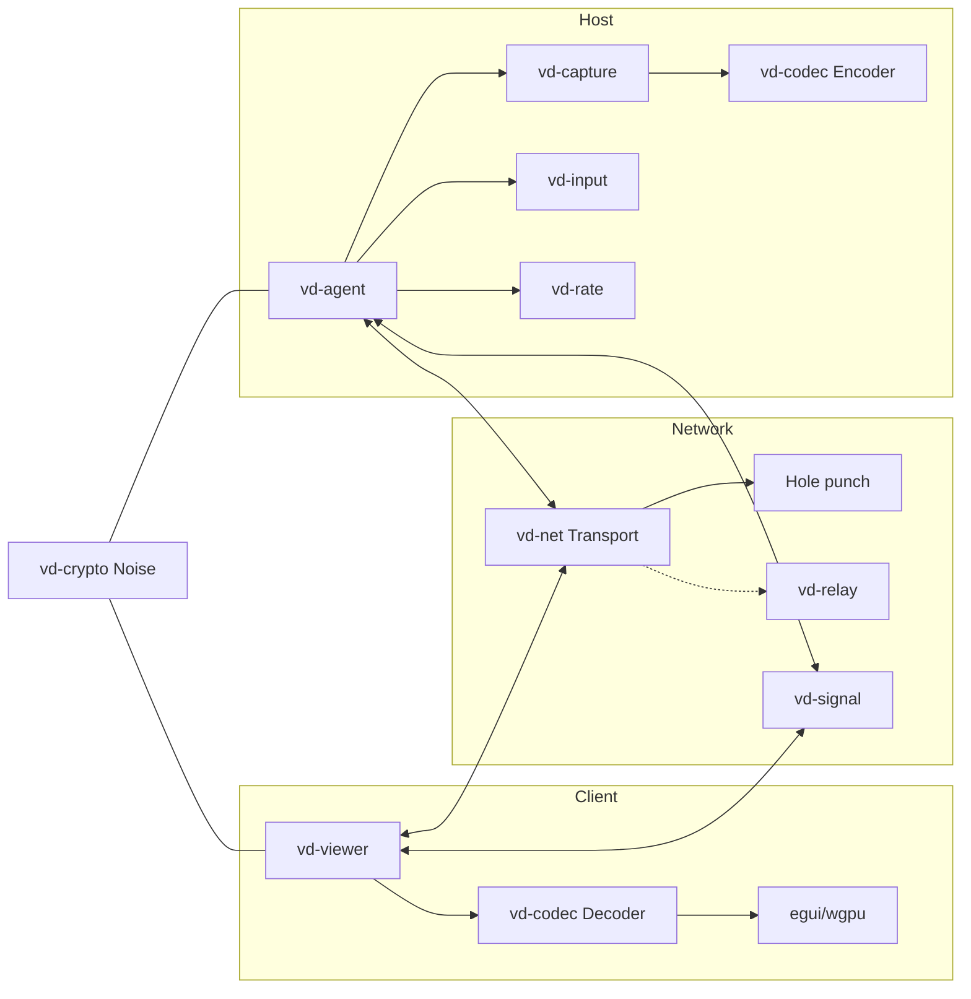
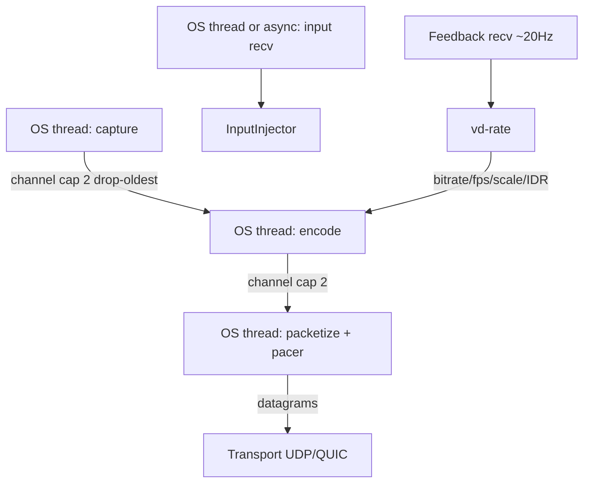
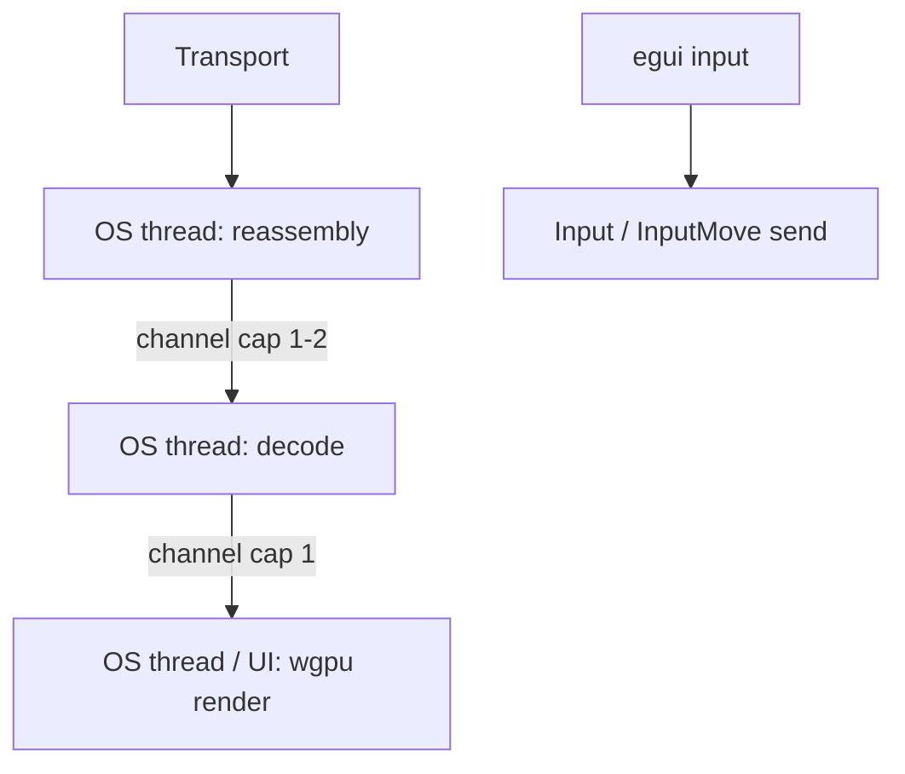

# Architecture — remote_viewer

## 1. Component diagram



## 2. Hot-path data flow and thread boundaries

### Host: capture → encode → send



Queue policy: **latest-frame-wins**. Never block capture on encode backlog.

### Viewer: recv → decode → render



Jitter buffer: **0–1 frame**. Render ASAP; no smoothing delay in v1.

## 3. Crate dependency graph

**Rule:** dependencies only point downward:

`apps/*` → feature crates → `vd-proto` / `vd-common`

```
apps: vd-agent, vd-viewer, vd-signal, vd-relay
tools: vd-bench, xtask

feature: vd-net, vd-capture, vd-codec, vd-rate, vd-input,
         vd-audio, vd-clipboard, vd-transfer, vd-crypto, vd-netsim

leaf: vd-proto → vd-common
```

Shared files (`Cargo.toml` workspace deps, `vd-proto` messages) are edited only by
**architect** or an explicitly assigned task — others request via [HANDOFF.md](HANDOFF.md).

## 4. Per-stage latency budget *(initial targets, to be validated)*

| Stage | Budget |
|-------|--------|
| Capture | ≤ 4 ms |
| Encode | ≤ 8 ms |
| Packetize + pace | ≤ 2 ms |
| Network | ≈ RTT/2 |
| Reassembly | ≤ 1 ms |
| Decode | ≤ 6 ms |
| Render (incl. vsync strategy) | ≤ 8 ms |

LAN glass-to-glass p50 ≤ 40 ms ⇒ non-network stages ~≤ 29 ms combined on the happy path.

Measurement method: [05_PERFORMANCE_BUDGET.md](05_PERFORMANCE_BUDGET.md).

## 5. Threading model

See [ADR-0001](adr/0001-rust-workspace-and-threading-model.md).

- Media hot paths: dedicated OS threads, no `.await`.
- Bounded `crossbeam-channel` between stages.
- Tokio: signaling HTTP/WS, relay event loop, connection setup/teardown only.
- Never run encode/decode on the tokio reactor thread.

## 6. Memory strategy

- Buffer pools for capture/encode scratch; prefer `bytes::Bytes` for wire buffers.
- **No per-frame heap allocation in steady state** (goal; enforce in P1/P5 with benches).
- Zero-copy GPU texture upload when HW path allows (P5).
- Cap clipboard/file chunk sizes; reject oversized framed messages.

## 7. Platform abstraction

Traits: `Capturer`, `Encoder`, `Decoder`, `Transport`, `InputInjector`, `RateControl`, `KeyStore`,
`ClipboardSync`. Platform modules are `cfg`-gated. Windows is the first production target.

## 8. Failure modes and recovery

| Failure | Recovery |
|---------|----------|
| Capture access lost (desktop switch / resolution) | Re-init capturer; force IDR |
| Encoder error | Restart encoder; IDR; optional SW fallback |
| Packet loss | NACK small gaps; IDR / intra-refresh; FEC on keyframes |
| Path dead | Probe direct vs relay; migrate; resume with IDR |
| Auth / consent revoke | Tear down immediately; release keys |
| Input disconnect | `release_all()` stuck keys |

## 9. Extension points

- Web viewer via WebTransport later (same `Transport` semantics).
- Mobile: separate apps consuming `vd-proto` / `vd-net`.
- Session recording: tap encoded bitstream (consent + indicator required).
- Alt transport: `str0m` WebRTC behind `Transport` ([ADR-0002](adr/0002-transport-quic-over-udp.md)).

## Related

[02_PROTOCOL.md](02_PROTOCOL.md) · [03_NETWORK_ADAPTATION.md](03_NETWORK_ADAPTATION.md) · [04_SECURITY.md](04_SECURITY.md)
